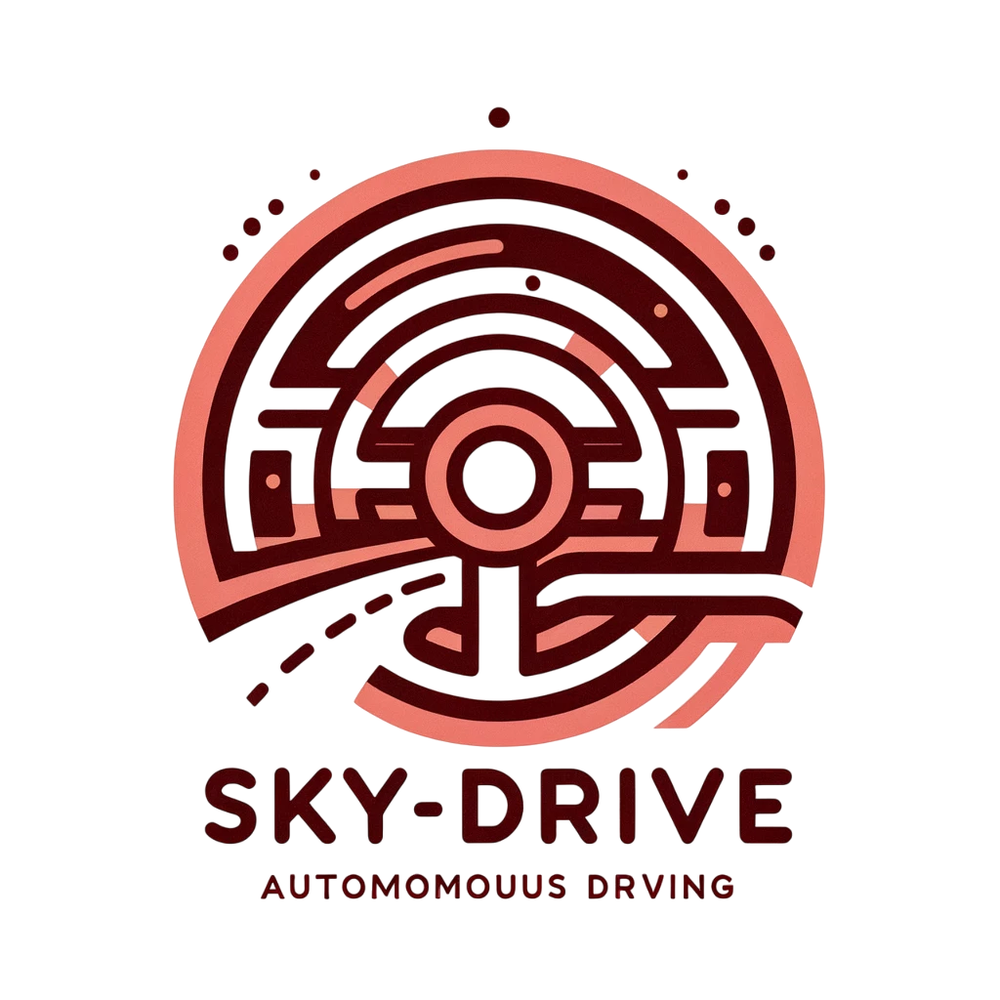

I'm a Ph.D. student at [University of Wisconsin–Madison](https://www.wisc.edu/), working with Dr. [Sikai (Sky) Chen](https://sky-lab-uw.github.io/people/) in [Sky-Lab](https://sky-lab-uw.github.io/). Before that I did my B.E. and M.S. at [Tongji University](https://en.tongji.edu.cn/), where I worked on vehicle dynamics and driving simulators for the Virtual Track Train.

My research is about getting autonomous driving to work outside the simulator. I work on [sim-to-real transfer](/research/#sim-to-real) — most recently [Sim2Real-AD](https://zilin-huang.github.io/Sim2Real-AD-website/), which runs simulation-trained driving policies on our full-scale test van — and on using [vision-language models and world models](/research/#vlm-world-models) to make driving decisions safer. I also help build [SkyDrive](https://github.com/BillWan-zzzyyy/Sky-Drive), Sky-Lab's open-source platform for studying how [human drivers, pedestrians and AI interact](/research/#human-ai).
