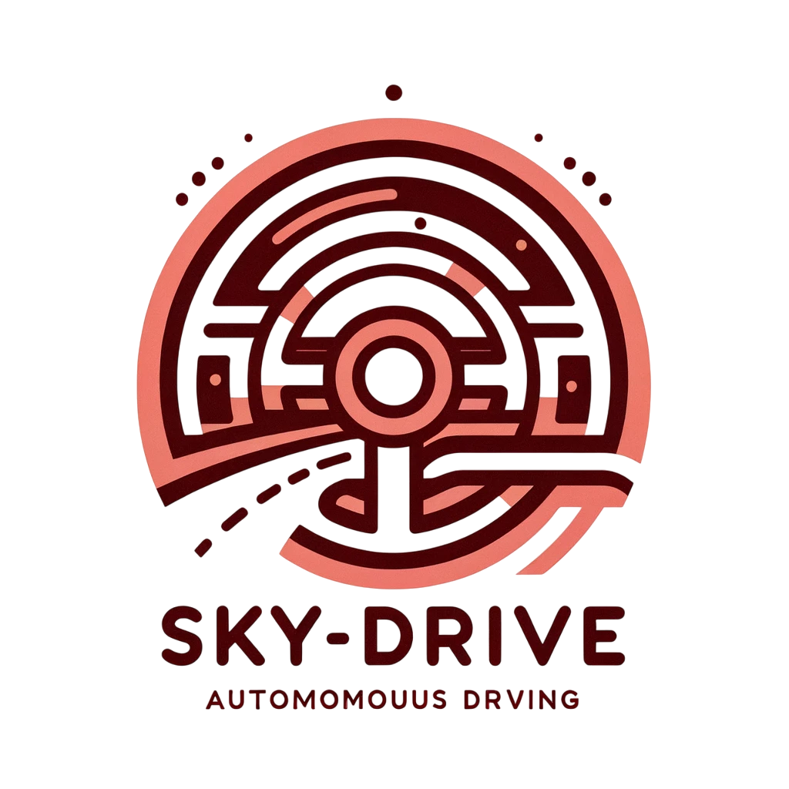

Hi! I am a **Ph.D. student** in the Department of Civil and Environmental Engineering at the [University of Wisconsin–Madison](https://www.wisc.edu/). I joined [Sky-Lab](https://sky-lab-uw.github.io/) in Fall 2025 under the guidance of Dr. [Sikai (Sky) Chen](https://sky-lab-uw.github.io/people/). Before that, I obtained my B.S. and M.S. from [Tongji University](https://en.tongji.edu.cn/).

I work on autonomous driving and human-centered intelligent transportation through simulation, real-vehicle testing, and human-AI collaboration. I contribute to [SkyDrive](https://github.com/BillWan-zzzyyy/Sky-Drive), Sky-Lab’s open-source multi-agent platform for future transportation systems and autonomous driving.
